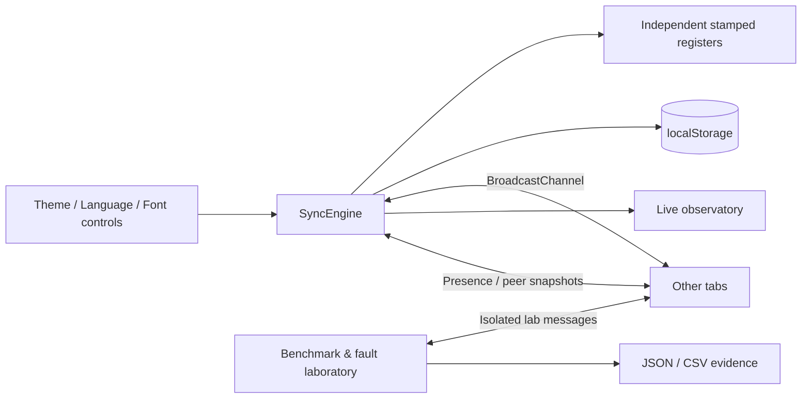

# SyncSphere

**GDG Tech Wildcard Entry · Frontend Development Task 1 · TypeScript · Release v2.3**

SyncSphere is a browser-based **multi-tab settings synchronization app and reliability lab**. Change appearance, language, or font size in one tab and watch every other open tab update without refreshing. Unlike a basic preferences page, SyncSphere also shows **why a conflict was resolved**, **whether replicas agree**, and **how cross-tab messaging behaves under controlled failures**.

The application uses TypeScript, `BroadcastChannel`, `localStorage`, the `storage` event, and browser DOM APIs. **No backend or login is required.** A small Node HTTP server is included for local development; the compiled `dist/` files are part of this repository for immediate startup and static hosting.

## Quick start (Windows PowerShell)

Prerequisite: **Node.js 18+** (Node.js 22 recommended).

```powershell
# Run from the extracted folder containing package.json
npm start
```

Visit **http://localhost:5173** in **three tabs** of the same browser profile. Each tab must use the *same address and port*. If port 5173 is occupied:

```powershell
$env:PORT = "5183"
npm start
```

Development and tests:

```powershell
npm install
npm test
npm run dev
```

> `npm start` uses bundled compiled JavaScript, so an npm install is not needed merely to open the demo. `npm test`, rebuilding and development require installing TypeScript.

**New to the project?** Read **[SETUP_GUIDE.md](docs/SETUP_GUIDE.md)**, including installation, screenshots/evidence capture, troubleshooting, and publishing to GitHub.

## What you can demonstrate

| Feature | Purpose |
| --- | --- |
| Live theme, language, and font-size synchronization | Meets the GDG challenge's core functionality |
| Persistence and pre-paint theme bootstrap | Keeps preferences after reopening without a flash of the wrong theme |
| Deterministic Lamport revision comparison | Resolves same-setting concurrent writes consistently |
| Live peer graph, activity log, fingerprints and diagnostics | Makes state changes and convergence explainable |
| 100-update ACK benchmark | Average, median, P95 and maximum measured **acknowledgment round-trip time** |
| 20 two-tab conflict trials | Tests that two real tabs agree on a deterministic winner |
| Three-tab fan-out and fault injection | Tests normal, drop-first, 150-ms delay and mixed scenarios with retries |
| Revision comparison and repair snapshots | Supports anti-entropy reconciliation after missed state messages |
| JSON/CSV exports plus verifier | Preserves raw samples and checks report integrity independently |

The 100-update benchmark uses isolated test registers, **not actual UI preference writes**. Fault injection also affects test traffic only; it cannot deliberately corrupt real saved preferences. ACK RTT is **not** equivalent to end-to-end UI paint time, and the optional cross-context one-way timing estimate is diagnostic only.

## Architecture in one view



A setting is stored as `{value, stamp: {counter, actor}}`. When two valid updates conflict, the register with the greater Lamport counter wins; a stable actor-ID comparison breaks equal-counter ties. All tabs apply the same comparison, allowing **eventual convergence**. `localStorage` supports persistence; peer presence and directed snapshots help detect and repair lagging state. This is **not** distributed consensus or a globally atomic multi-setting transaction.

## Tested results

A Windows user-side Playwright Chromium run on **19 October 2026** reported:

| Test | Observed result |
| --- | --- |
| 100 sequential benchmark updates | PASS |
| 20 conflict trials | PASS |
| Normal fan-out, 3 tabs | 24/24 ACKs, P95 0.50 ms (successful-attempt RTT) |
| Drop-first fan-out | 24/24 ACKs, 24 recovered, P95 0.90 ms |
| 150-ms delayed-ACK fan-out | 24/24 ACKs, P95 162.30 ms |
| Mixed fault fan-out | 24/24 ACKs, 12 recovered, P95 157.20 ms |
| Browser persistence and JSON/CSV validation | PASS; 144 matched records |
| Approximate one-way estimate higher than RTT | 18 flagged observations, not failed ACKs |

**Provenance:** these are results from the project owner's console output, not a new benchmark on an arbitrary machine. The **raw V2.3 JSON/CSV exports are not included** because they have not been provided for this release package. To attach complete V2.3 evidence, follow [EVIDENCE_AND_RESULTS.md](docs/EVIDENCE_AND_RESULTS.md). Verified earlier-version raw JSON/CSV files remain under `evidence/v2_1_browser_baseline/` and `evidence/v2_2_browser_baseline/`.

The deliberately injected 150-ms delay is **not** a failure of the challenge's normal sub-100-ms target. For the target itself, assess the normal unfaulted path and real preference behavior; the test-register ACK RTT is supporting protocol evidence, not sufficient alone to establish UI end-to-end latency.

## Testing

```powershell
npm install
npm test
```

With `npm start` running in another terminal:

```powershell
python -m pip install playwright
python -m playwright install chromium
python tests/browser_v23.py http://localhost:5173

python scripts/verify_evidence.py `
  ".\tests\artifacts\v23_latest\syncsphere-v2.3-evidence.json" `
  ".\tests\artifacts\v23_latest\syncsphere-v2.3-samples.csv"
```

The browser script covers 3 Chromium tabs, 100 updates, 20 collisions, all four fault modes, a real font setting update, saved-state reopening, and export verification. Note that its **144-row export records only the latest (Mixed) fan-out mode**, not 24 rows from each of the four modes. Retain the console output and export individual reports for all modes if required.

For the full manual scenarios, repeatable testing practices and expected outcomes, use **[TEST_INSTRUCTIONS_V2_3.md](docs/TEST_INSTRUCTIONS_V2_3.md)**.

## Project structure

```text
SyncSphere/
├── index.html                  # Early theme bootstrap + user interface
├── assets/styles.css           # Responsive styles
├── src/                        # TypeScript application code
│   ├── main.ts                  # UI orchestration
│   ├── i18n.ts                  # English, Hindi, French, Spanish
│   └── core/                    # Registers, sync engine, labs, reports
├── dist/                       # Checked-in JavaScript for npm start/static hosting
├── scripts/                    # Local static server and evidence validator
├── tests/                      # Node tests and 3-tab Playwright acceptance test
├── evidence/                   # Historical raw reports and V2.3 results notes
├── docs/                       # Setup, architecture, test procedures and handover
├── .github/workflows/ci.yml    # GitHub Actions: TypeScript + tests + evidence checks
└── package.json
```

## Docs for contributors and judges

- **[Setup & GitHub upload guide](docs/SETUP_GUIDE.md)**: prerequisites, commands, common errors, GitHub push, optional static deployment.
- **[Evidence and verified test results](docs/EVIDENCE_AND_RESULTS.md)**: real observed metrics, limitations, how to attach raw V2.3 output.
- **[Testing and reproducibility runbook](docs/TEST_INSTRUCTIONS_V2_3.md)**: manual acceptance tests, failures, comparable repeated runs.
- **[Technical design](docs/TECHNICAL_DESIGN.md)** and **[V2.3 audit](docs/V2_3_AUDIT_AND_FIXES.md)**: why each component exists.
- **[Beginner explanation](docs/EXPLAIN_LIKE_IM_FIVE.md)** and **[3-minute demo](docs/DEMO_SCRIPT_V2_3.md)**: how to present the project.
- **[Continuation guide](docs/V2_3_CONTINUATION.md)**: implementation handoff.
- **[Submission checklist](docs/GITHUB_SUBMISSION_CHECKLIST.md)**: final pre-publication checks.

## Scope and known limitations

- Synchronization is for multiple tabs on the **same origin and browser profile**, not multiple devices.
- Cross-tab state is eventually consistent and conflict winners follow **Lamport ordering**, not necessarily the most recent wall-clock click.
- `localStorage` can be disabled or cleared by privacy settings. Tab-discovery heartbeats and timing can be delayed by background-tab throttling.
- Benchmarks depend on browser, CPU, power mode, visibility and operating-system scheduling. Do not promise identical millisecond output in every run.
- Fingerprints are compact state diagnostics, **not cryptographic integrity proofs**.
- The archived V2.1/V2.2 docs and measurements are historical; use the V2.3 documents above for current procedures.

**Submission status:** complete source and runnable test suite are packaged. A public GitHub URL and a live deployment URL must be added **after publishing**; neither has been invented here. Add license terms only after choosing a license.
